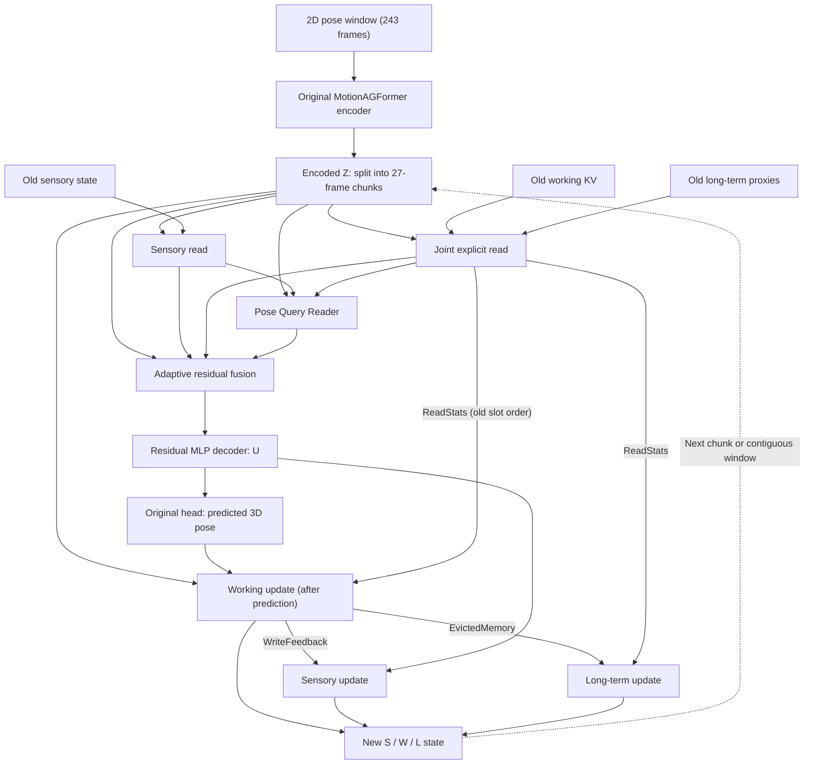

# MotionAGFormer — Coordinated Memory (V1)

**Research fork | Branch: `memory-v1` | Experimental, not a validated benchmark model**

This branch investigates whether a coordinated sensory, working, and long-term memory system can improve monocular 3D human pose estimation (3D HPE). It retains the original MotionAGFormer backbone and adds a post-backbone memory system, together with a sequence-aware training and evaluation protocol.

The original MotionAGFormer is the WACV 2024 work by Soroush Mehraban, Vida Adeli, and Babak Taati. The unmodified reference is preserved on [master](https://github.com/lite-tx/MotionAGFormer/tree/master) (base commit `4756fd1eb7cc73f0e991f091ff2280e030ab85f3`). See its [original README](https://github.com/lite-tx/MotionAGFormer/blob/master/README.md) for upstream instructions, citations, data, and model weights. **This branch is not the authors' official memory model.**

> Status (2026-11-25): implementation and development smoke tests are complete enough to begin server-side preflight. Full-size training, real Human3.6M data validation, official checkpoint loading, CUDA performance, accuracy comparisons, and evidence of memory synergy are still pending. Do not report an accuracy gain or a successful full-scale training run.

## 1. Research question and design rationale

A bidirectional pose-estimation encoder already models spatial and temporal dependencies within a fixed input window. The question here is not simply how to add another temporal attention block. We want to investigate whether historical information can be represented, retained, compressed, retrieved, and exchanged in complementary ways, including across encoder windows, without expanding persistent state with video length.

| Memory | Intended role | Representation |
| --- | --- | --- |
| Sensory (S) | Continuous motion/state information and short-range evolution | Per-joint recurrent matrices |
| Working (W) | Accessible, relatively recent or relevant detailed historical poses | A bounded bank of frame-level, joint-wise key/value records |
| Long-term (L) | Compressed historical patterns beyond the working bank's capacity | A bounded bank of joint-wise latent pose proxies |

The research hypothesis is that these representations and their interactions can be more useful together than isolated additions. This is a hypothesis, not an observed result. In particular, W-to-S feedback and W-to-L transfer are explicit coordination paths whose value must be tested separately from model capacity and independent memory benefits.

### Design lineage, not wholesale module transplantation

The three-memory lifecycle is inspired by XMem. The design adapts GDNv2 (recurrent update), SAMA (structure-aware interaction and motion-adaptive modulation), RMem (relevance/freshness retention), TCPFormer/PUM and ReWind (pose proxy and learnable historical aggregation ideas), and Cutie (higher-level query interaction). These are inspirations for a task-specific implementation; the branch does not claim exact reproduction of their architectures, objectives, or results. In particular, ReWind is not a separately instantiated network, and the Cutie-inspired tokens are not a fourth persistent memory.

## 2. Architecture and runtime contract

Default Human3.6M Base configuration:

- Input: `[B,243,17,3]` (normalized 2D coordinates and confidence).
- Original encoder: 16 AGFormer blocks, feature width 128, representation width 512.
- Encode **the full 243-frame window first**, producing `Z: [B,243,17,512]`.
- Partition Z into nine 27-frame chunks. The original AGFormer block internals are unchanged.
- Each chunk reads only the incoming S/W/L state, predicts its poses, then updates memory. Carry state into the next chunk and, optionally, the next contiguous window.
- Original linear regression head (512 to 3) is retained.



**Important:** historical memory scheduling is chronological at chunk boundaries, but the original encoder is bidirectional over the whole window. This is not a strictly causal or zero-latency streaming model. Within a chunk, all predictions see the same incoming memory snapshot, not the current chunk's writes.

### Sensory memory

Source: [gdnv2.py](model/memory/gdnv2.py), [sama.py](model/memory/sama.py), [sensory.py](model/memory/sensory.py).

- State matrix: `[B,17,4,32,32]`, kept in FP32. Also stores the last valid SSI feature and stream validity.
- Joint-shared projections, distinct state per joint. SSI uses the original skeleton topology (symmetrized, with learnable soft interactions) to contextualize features and temporarily contextualize state for reading.
- Q/K are derived from SSI-enhanced Z; V, base decay, erase and write gates from decoded feature U.
- GDNv2-inspired read/update are separated. The write scans valid frames in order after prediction; recurrence uses channel-wise decay, erase and write. MSM modulates log decay using the current and preceding SSI feature, including across chunk boundaries.
- Deep Update uses the actual saved W value and an aligned admission mask to correct erase/write logits. Unadmitted frames use the normal update. The correction is initially zero. No ground-truth 3D enters memory.
- SSI, MSM and Deep Update have individual configuration switches.

### Working memory

Source: [working.py](model/memory/working.py).

- Capacity N=9 frame records, each with 17 joint keys (64 channels) and values (128 channels). Q and K share a normalized linear projection of Z.
- Values combine a residual observation projection with an embedding of the model's **predicted** 3D pose: V = E_z(Z) + MLP([E_z(Z), E_p(prediction)]).
- Admit frames every nine absolute stream-local frame IDs (zero-based IDs 8,17,26,...); a full chunk admits three. Not a learned write selector. New admissions are protected for that update.
- Before eviction, update old-record relevance by EMA of actual shared-attention mass per valid joint query. RMem-inspired retention score: relevance + freshness_weight * sqrt(2 log(sum(age)) / age), using positive residence ages in valid frames. Evict the lowest-scoring old records when necessary; tie-break by oldest timestamp.
- Output `WriteFeedback` (time-aligned admission mask and actual stored V) to Sensory; output complete evicted KV and metadata to Long-term. Do not discard or detach feature paths simply because a record is evicted.

### Long-term memory

Source: [long_term.py](model/memory/long_term.py).

- Capacity L=16, initially empty. Only latent proxies `[B,16,17,128]` are persisted, not another unbounded KV bank. Project proxies into explicit K/V on demand.
- Evicted W KV is mapped into a latent candidate. Full-pose cosine similarity compares flattened joint keys in the shared retrieval key space; threshold 0.75 by default. This is hard routing, not a separately trained descriptor or discrete differentiable classifier.
- Matching candidates are grouped per proxy. PUM performs joint-wise attention over assigned candidates and bounded gated interpolation: P' = (1-g)P + g * summary, with initial g=0.2. For a single candidate attention is trivially one, but the gate still controls the update.
- Novel candidates seed free slots or replace eligible slots with the lowest accumulated attention usage / exposure. Newly admitted and matched slots are protected in the current update; default minimum exposure is 459 valid joint queries. If no slot is eligible, the candidate is dropped rather than buffered indefinitely.
- Store usage, exposure, creation/update times, source frame range, support count, and validity. Source ranges are provenance metadata, not exact proxy timestamps.

### Joint retrieval, pose queries and prediction

Source: [retrieval.py](model/memory/retrieval.py), [decoder.py](model/memory/decoder.py).

- For each current joint query, compute cosine similarity to historical keys for that same joint. W and L compete in **one** masked softmax over valid slots. The learned log-relative-time bias applies to exact W timestamps only (zero-initialized); no fabricated time is assigned to L proxies. Use a shared bias-free output projection for both readouts.
- R_W and R_L retain their portions of the joint attention mass; do not renormalize separately. `ReadStats` accumulates these weights over valid joint queries, in the incoming slot order, for memory management. It measures retrieval usage, **not** final causal contribution to prediction.
- Cutie-inspired Pose Query Reader collects joint features (Z and the three readouts) into six temporary per-frame queries (global, torso/head, left/right arm, left/right leg), exchanges information between queries, and feeds back a joint correction. Soft body biases follow H36M indices; no time mixing or persistent fourth memory.
- Fusion gates over skip, S, combined explicit (W+L), and pose correction, with unavailable options masked. The original Z is always an unweighted residual.
- H = Z + g_s R_S + g_e (R_W + R_L) + g_p R_pose.
- U = H + eta * (g_s + g_e + g_p) * MLP(LN(H)); prediction = original Head(U). The decoder is a lightweight residual MLP, not a standard Transformer decoder.
- With no available history, the valid-frame path is an exact feature bypass. With all sources available, initial memory gate mass is 0.1 and skip mass 0.9; this is not a measured fraction of feature contribution.

### Memory state and gradient rules

Source: [state.py](model/memory/state.py), [memory_system.py](model/memory/memory_system.py), [config.py](model/memory/config.py).

- MemoryState is explicit caller-owned data, not learned weights or hidden model buffers.
- The model's normal `forward(x)` starts an independent window; `return_rep=True` retains the original pre-memory representation. Use `forward_window(x, state, frame_ids, valid_mask, stream_ids)` to continue a video.
- Frame IDs are int64 and consecutive for valid frames; masks are boolean and padding is a suffix. Overlapping, reversed, or gapped windows may not reuse state. Batch row order and state layout must align; a changed active stream resets that row rather than migrating memory.
- All-padding rows must not read/write or advance state. No current chunk information may enter its historical read. Do not pass ground-truth poses into a write encoder.
- Feature paths remain differentiable across chunks and windows within an episode; routing, ranking and usage statistics are nondifferentiable management operations. Fixed state capacity does **not** imply fixed training activation memory.
- `MemoryConfig(enabled=False)` registers no new memory parameters and preserves the original computation and state_dict keys.

## 3. Training and data protocol

Scope: H36M, 17-joint order, root index 0. The current memory topology, pose queries, data reader, and loss have not been adapted to MPI-INF-3DHP. The upstream MPI path is unchanged.

Obtain the original MotionBERT-format H36M PKL with fine-tuned Stacked Hourglass detections using the upstream [data instructions](https://github.com/lite-tx/MotionAGFormer/blob/master/README.md#human36m). Place the trusted file at:

```text
data/motion3d/h36m_sh_conf_cam_source_final.pkl
```

The new [H36MEpisodeDataset](data/reader/h36m_episode.py) reads this file directly, not the old identity-free `H36M-243` clip PKLs. It groups contiguous runs by `source` AND `camera_name`, normalizes coordinates as in the original reader, and provides stream-local frame IDs, global frame indices, validity masks, and identity metadata. The order of original frames is assumed chronological within each run; verify that assumption on real data.

| Level | Default | Meaning |
| --- | --- | --- |
| Video/stream | Variable length | Reset when identity changes |
| Episode | 2 x 243 = 486 frames | Independent training sample and gradient horizon |
| Window | 243 frames | Full backbone encoding unit |
| Chunk | 27 frames | Memory read/predict/write unit |
| W admission stride | 9 frames | Independent of chunk/window boundaries |

- Train episode stride is 81 frames. Different episodes may overlap, but state resets at every episode entry, including repeat visits in later epochs.
- Shuffle entire episodes, never their internal windows or chunks. Draw one horizontal flip for all input and target windows in an episode.
- Keep tail frames using suffix padding (repeat the last observation for the fixed-size encoder; invalid IDs = -1, targets padded with zeros). Exclude padding from losses and memory updates. Fully padded rows are skipped by the trainer. Partial-window padding remains visible to the original bidirectional encoder and BatchNorm; it is not a backbone attention mask.
- Train on a batch of episodes; perform one forward over each consecutive window, keep the graph through the whole episode, then backpropagate. Never update optimizer parameters between the windows of one episode. No automatic state carry across training batches or optimizer steps.

### Objective and provisional optimizer settings

[EpisodePoseLoss](loss/episode_pose3d.py) retains the original H36M objective:

```text
loss = MPJPE + 0.5 * N-MPJPE + 20 * VelocityLoss
```

Only targets receive root-relative subtraction during training, as in the upstream trainer. The FP32 loss excludes invalid frames, guards the scale-fit denominator, and counts only adjacent valid frames with consecutive IDs, including true chunk/window boundaries. No auxiliary memory loss, bone/angle loss, or additional supervision is enabled.

[Episode trainer](utils/episode_trainer.py) and [memory Base config](configs/h36m/MotionAGFormer-memory-base.yaml):

| Setting | Starting value |
| --- | --- |
| Initialization | Scratch; optional original pretrained warm-start |
| Optimizer | AdamW; train all parameters |
| Learning rate / weight decay | 5e-4 / 0.01 |
| Per-epoch LR multiplier | 0.99 |
| Epochs | 60 (not an equal-budget claim) |
| Microbatch | 2 episodes |
| Accumulation | 4 microbatches |
| Precision | FP32 by default; BF16 optional |
| Gradient clipping | Optional; disabled in default config |

Accumulate position/scale and velocity gradients with their separate effective valid-frame and frame-pair denominators. Gradient accumulation is not identical to a larger physical batch when BatchNorm is present. The V1 trainer is single-device; no DP/DDP wrapper, FP16 scaler, or gradient checkpointing is implemented. Longer episodes, TBPTT and other memory-saving strategies remain future choices. These hyperparameters are unvalidated starting points.

## 4. Evaluation and checkpoint contract

[episode_evaluation.py](utils/episode_evaluation.py) implements `h36m_continuous_full_frames_v1`:

- Ordered evaluation, batch size one; carry memory through each real video including across evaluation episode boundaries; reset on a new run. No training shuffle or random flip in the test Dataset.
- Optional flip TTA uses a separate persistent state for the original and mirrored path, then unflips and averages predictions.
- Restore coordinates using the original 2.5D factors and root-relative protocol; retain the original three sequence exclusions. Report action-macro MPJPE, P-MPJPE, per-joint errors, and acceleration error over valid consecutive triples (including window boundaries).
- Include eligible tail frames once, with no resampling. This differs from the original clip coverage and acceleration aggregation. **Do not directly compare numbers from these two protocols as if they were identical.**

[episode_checkpoint.py](utils/episode_checkpoint.py) supports strict original backbone/head warm-start (only new memory keys may be missing), exact model loading, and epoch-boundary resume of optimizer, scheduler, RNG and config. Checkpoints contain model parameters, not dynamic video memory. The current CLI follows upstream selection of best epoch on test MPJPE; a separate validation split / fixed selection policy is needed for a rigorous final test report.

## 5. Reproduce the implementation and server preflight

Use the experimental branch explicitly:

```bash
git clone -b memory-v1 https://github.com/lite-tx/MotionAGFormer.git
cd MotionAGFormer
pip install -r requirements.txt
```

Upstream documents Python 3.8.10, PyTorch 2.0.0 and CUDA 12.2. Development tests used a CPU PyTorch environment; verify dependency and CUDA compatibility on the actual server. Do not load untrusted PKLs or checkpoints.

Run a reduced-size **actual AGFormer** training smoke test (synthetic input):

```bash
python verify_memory.py --tiny --device cpu --steps 5
python -m unittest model.memory.test_end_to_end -v
```

On the server, start with full Base inference. Then explicitly request one optimizer step (BF16 only on supported hardware), then real-data smoke training:

```bash
python verify_memory.py --device cuda
python verify_memory.py --device cuda --precision bf16 --batch-size 1 --steps 1
python verify_memory.py --device cuda --precision bf16 --batch-size 1 --steps 5 --data data/motion3d/h36m_sh_conf_cam_source_final.pkl
```

`verify_memory.py` reports parameter counts, losses, parameter update magnitudes, elapsed time and CUDA peak allocation/reservation when applicable. It does not create training checkpoints. The repeated-batch loss is a smoke diagnostic, not a generalization result. Optionally supply `--pretrained PATH` for an original Base checkpoint. If BF16 is unsupported, use FP32. Choose actual microbatch/accumulation only after measuring peak memory.

Once preflight succeeds, use the new CLI rather than upstream `train.py`:

```bash
python train_memory.py --config configs/h36m/MotionAGFormer-memory-base.yaml --output-dir checkpoint/memory-v1
```

Other modes (use the same configuration and seed as the run where applicable):

```bash
# Warm-start, fresh optimizer and memory parameters
python train_memory.py --pretrained checkpoint/motionagformer-b-h36m.pth.tr --output-dir checkpoint/memory-pretrained

# Continue the same run at an epoch boundary
python train_memory.py --resume checkpoint/memory-v1/latest_epoch.pth.tr --output-dir checkpoint/memory-v1

# Exact-model evaluation; optionally add --reset-memory
python train_memory.py --eval-only --checkpoint checkpoint/memory-v1/best_epoch.pth.tr
```

The original Base weights are linked in the [upstream README](https://github.com/lite-tx/MotionAGFormer/blob/master/README.md#evaluation). The output directory contains best/latest checkpoints and `metrics.jsonl`; do not overwrite previous experiments. For matched baseline training, copy the memory YAML, set `memory.enabled: False`, and use the same new CLI with a separate output directory. Keep all other settings matched.

## 6. Evidence and limitations (development handoff)

The following is the recorded development-test status, not a new benchmark or a reproducibility guarantee. See `verify_memory.py` and the unit tests for executable checks.

| Check | Recorded status |
| --- | --- |
| Original AGFormer blocks, disabled-path compatibility | Source comparison and CPU output check passed |
| Full 16-layer Base forward, two 243-frame windows | CPU synthetic inference passed |
| Cross-window gradients and parameter updates | Reduced actual AGFormer + all three memory modules passed |
| BF16 training | Reduced model on CPU passed |
| Dataset, loss, trainer, evaluator and checkpoint integration | Synthetic-data development tests passed |
| Full-size two-window backward | Attempt stopped at the development container's memory limit; **not passed** |
| Real H36M PKL, official pretrained file, CUDA training | **Pending server verification** |
| Accuracy, synergy, generalization | **No experimental evidence yet** |

Previous CPU development report counted 11,723,811 baseline parameters and 13,575,374 memory-model parameters (+1,851,563, approximately 15.79%). Reproduce with the preflight script. These counts are not MACs or training-memory estimates. The last development run reported 74 tests (including three real-backbone regressions), not a fresh run of every earlier unit test. Missing `timm` was bypassed only for the inactive DropPath import in the zero-drop-path CPU test; full dependency-environment verification remains necessary.

Other open risks:

- Shared W/L softmax may favor the more numerous source slots, and relative-time bias or learned key/value distributions can favor one bank. Retrieval usage is measured before fusion, not after it.
- Predicted poses feed back into memory; useful self-conditioning and accumulated errors are both possible. Hard routing can drop novel candidates and singleton PUM attention has no competition.
- A fixed number of latent proxies may not represent diverse historical motions. Age, threshold, exposure, and gate defaults need empirical study.
- Training histories are bounded by episode length, whereas evaluation histories span whole videos. Assess the resulting train/eval mismatch, not just aggregate MPJPE.
- Partial padding can affect original backbone activations. Neither chronological memory writes nor suffix masks make the encoder causal.
- The extra learnable modules, changed data exposure, effective batch, and added boundary velocity supervision are confounders unless carefully controlled.

## 7. Next research steps (not yet performed)

1. On the user's server: verify real PKL shapes, source/camera runs and chronological order; verify official weight loading, dependency compatibility, full-scale forward/backward, finite gradients, and GPU memory/time. Log the environment and exact commit.
2. Establish a matched original-backbone baseline using the episode protocol and identical loss, data, TTA, seeds, checkpoint selection and training budget. For comparison to the published result, also use the original clip protocol and label it separately. An epoch on 486-frame episodes with 81-frame stride is not the same exposure budget as an original 243-frame clip epoch.
3. Compare the full memory system against the matched baseline; report parameters and measured computation/latency. Use `--reset-memory` with the **same trained model** to isolate the value of cross-window carry (not to disable memory within a window).
4. Design memory-specific and parameter-matched ablations before claiming mechanism-level gains: S/W/L contributions, W-to-S Deep Update, W-to-L transfer, shared reader, proxy update/retention, and pose correction. Only SSI/MSM/Deep Update and the full memory switch currently have built-in config switches; other ablations require deliberate implementation. Do not pretend all combinations already run.
5. Collect diagnostics over time: error by chunk/window position and action, gate mass, source attention mass and occupancy, admission/eviction and proxy merging/rejection, support counts, gradient magnitude, prediction drift, and cross-window boundary errors. These are planned measurements, not a claim that all are currently logged by the trainer.
6. Introduce new loss terms or architectural changes only in response to measured failure modes. Preserve controlled comparisons. Demonstrating that three memories can run together is not proof that their interaction is synergistic.

## 8. Code map and AI/developer handoff

| Path | Responsibility |
| --- | --- |
| [model/MotionAGFormer.py](model/MotionAGFormer.py) | Original model class + post-encoder memory integration |
| [model/memory/config.py](model/memory/config.py), [state.py](model/memory/state.py) | Dimensions, validity, stream ownership and state contracts |
| [model/memory/gdnv2.py](model/memory/gdnv2.py), [sama.py](model/memory/sama.py), [sensory.py](model/memory/sensory.py) | Sensory recurrence and cooperative update |
| [model/memory/working.py](model/memory/working.py), [long_term.py](model/memory/long_term.py) | Explicit banks, retention, transfer, proxy update |
| [model/memory/retrieval.py](model/memory/retrieval.py), [decoder.py](model/memory/decoder.py) | Joint retrieval, pose correction, fusion and decoder |
| [model/memory/memory_system.py](model/memory/memory_system.py) | Authoritative read/predict/write scheduler |
| [data/reader/h36m_episode.py](data/reader/h36m_episode.py), [loss/episode_pose3d.py](loss/episode_pose3d.py) | Training/evaluation metadata and masked supervision |
| [utils/episode_trainer.py](utils/episode_trainer.py), [episode_evaluation.py](utils/episode_evaluation.py), [episode_checkpoint.py](utils/episode_checkpoint.py) | Optimization, metrics and persistence |
| [train_memory.py](train_memory.py), [verify_memory.py](verify_memory.py) | Training/evaluation CLI and preflight |
| [configs/h36m/MotionAGFormer-memory-base.yaml](configs/h36m/MotionAGFormer-memory-base.yaml) | Current experimental starting configuration |

When taking over this branch, read the scheduler and state contracts before editing. Inspect actual implementations rather than interpreting module names as literal reproductions of papers. Preserve the original AGFormer blocks and disabled baseline; do not introduce a wrapper architecture, silently change memory semantics, use target poses in writes, or alter evaluation coverage without a matched control. Keep code, hypotheses, and measured evidence separate. Report exact commands, commit IDs, environment, tests actually executed, failures, and data availability. The original master branch is the reference and should remain unchanged.

## Acknowledgements and citation

This work builds on MotionAGFormer and its upstream dependencies/data preparation, including MotionBERT, P-STMO, and MHFormer. Credit the original authors for their implementation and cite their paper when using this fork. The upstream README contains the original acknowledgements and weight/download links.

```bibtex
@inproceedings{motionagformer2024,
  title     = {MotionAGFormer: Enhancing 3D Human Pose Estimation with a Transformer-GCNFormer Network},
  author    = {Soroush Mehraban, Vida Adeli, Babak Taati},
  booktitle = {Proceedings of the IEEE/CVF Winter Conference on Applications of Computer Vision},
  year      = {2024}
}
```
